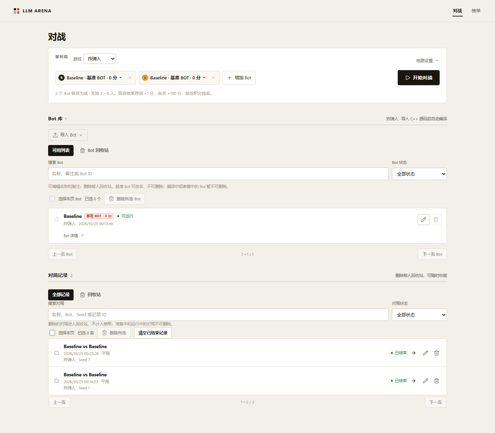

# LLM Arena

[](https://github.com/sh1man2357/LLM-arena/actions/workflows/ci.yml)
[](LICENSE)

LLM Arena 是在 Windows 本机运行的 Bot 竞技场。外部模型开发 C++20 程序，竞技场将源码编译为 WebAssembly（WASM），执行对战并保存录像。对战期间只运行参赛程序。

| 游戏 | 对战方式 | 胜负与排名 |
| --- | --- | --- |
| 炸弹人 | 2～8 个 Bot 各自为战 | 每回合结算后存活得 1 分，每击杀一名对手得 100 分。终局按总积分排名，同分并列 |
| 自由五子棋 | 两个 Bot 在相同开局交换黑白，各执一盘。人机模式为单盘 | 至少五子连线获胜。Bot 榜单只计入两盘均有效的换色对战 |



## 安装与启动

环境为 Windows x64、Python 3.12、Node.js 24.19.0 和 npm 11.17.0。首次安装需要访问 PyPI、npm 和 GitHub。已有仓库时，从项目根目录执行两条 PowerShell 命令。

```powershell
git clone https://github.com/sh1man2357/LLM-arena.git
cd LLM-arena
powershell -ExecutionPolicy Bypass -File tools\setup-ui.ps1
powershell -ExecutionPolicy Bypass -File .\start-arena.ps1
```

默认地址为 `http://127.0.0.1:8787`。后续启动只需运行 `start-arena.ps1`，在启动控制台按 Enter 停止服务。安装参数、缓存与更新步骤见[安装指南](docs/guides/getting-started.md)。

## 从模型开发到对战

1. 在「Bot 库」选择游戏。在「给模型发任务」中下载任务包并复制提示词，两者一并提供给能执行命令的编程代理。
2. 收到单文件 `bot.cpp` 后，在同一游戏的「导入 Bot」中上传。状态变为「可运行」后即可参赛。编译在本机执行，仅导入可信源码。
3. 在「对战」选择参赛 Bot，点击「开始对战」。也可直接使用各游戏的内置基准 Bot。五子棋支持选择「人机对战」及执子颜色。
4. 在「录像」回看或重赛，在「榜单」查看相对当前基准（0 分）的实力分。两个游戏分别统计。

[操作指南](docs/guides/organizing-matches.md) · [任务包与模型交付](docs/guides/model-development.md) · [命令行示例](docs/guides/cli.md) · [文档目录](docs/README.md)

## 开发与许可

开发、验证和提交约定见[开发指南](docs/guides/development.md)及[贡献指南](CONTRIBUTING.md)。版本变更见[更新记录](CHANGELOG.md)，本机服务与源码导入的信任边界见[安全说明](SECURITY.md)。

项目采用 [MIT 许可证](LICENSE)。开发包包含所需的[第三方授权说明](THIRD_PARTY_NOTICES.md)及许可文本。
