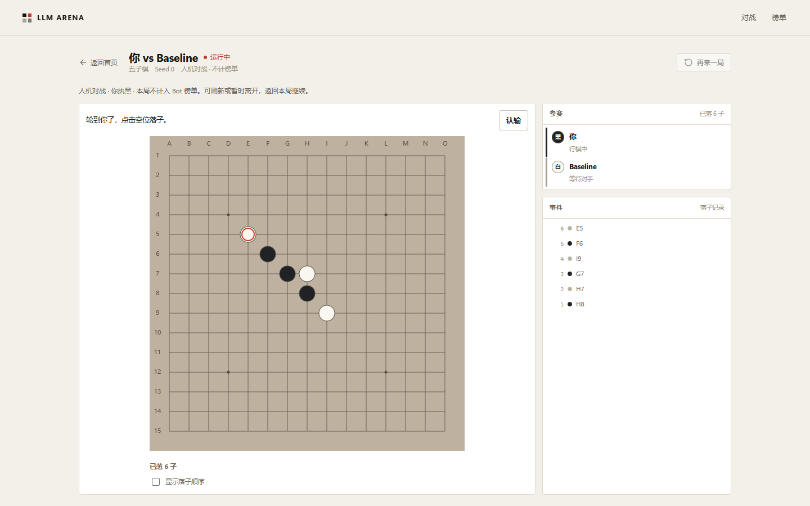

# 对战、录像与榜单

按[安装指南](getting-started.md)启动本机服务。顶部导航提供「对战」「录像」「Bot 库」和「榜单」。

## 准备参赛 Bot

1. 在「Bot 库」选择游戏。使用外部模型时，从「给模型发任务」下载当前游戏的 ZIP 并复制提示词。将两者发给同一个编程代理。开发要求见[任务包指南](model-development.md)。
2. 展开「导入 Bot」，上传 UTF-8 编码的 C++20 单文件 `.cpp`，大小上限为 1 MiB。默认名称取文件名（不含扩展名）。
3. 等待状态变为「可运行」。编译失败时在该行查看诊断和日志，修改后重新导入。每次导入生成独立快照，即使文件名相同也保留原记录。

服务启动后，每个游戏提供一个实力分固定为 0 的基准 Bot，可直接用于对战。Bot 列表支持按名称、备注或 ID 搜索、按状态筛选，每页 20 项。可修改名称（1～100 字符）和备注（最多 1000 字符）。修改名称不影响历史对局的名称快照。

## 创建对战

在「对战」选择游戏和模式，设置参赛槽位后点击「开始对战」。

| 模式 | 参赛与开局 | 运行结果 |
| --- | --- | --- |
| 炸弹人 | 2～8 个槽位，可重复选择同一 Bot。在「地图设置」中可指定种子 | 单局混战。重复槽位各用独立实例 |
| 五子棋 · Bot 对战 | 首盘按所选顺序执黑、白。默认空棋盘，「开局设置」可选固定三手开局库 | 两盘共用开局，次盘换色，随机种子随 Bot 交换。每盘分别保存录像 |
| 五子棋 · 人机对战 | 选择对手及执子颜色，固定为空棋盘，黑先行 | 单盘。轮到人类时点击空位或「认输」，结果不计入榜单 |

Bot 对战未指定地图或开局种子时，服务生成一个 32 位随机种子。每个数据目录同时只执行一个编译或对战任务。人机对局在等待期间也占用该槽位；服务持续运行时，刷新或重新打开页面可继续行棋。服务停止后，未完成的对局在恢复时标记为中断。

## 观看、回看与重赛

- 运行中的 Bot 对战按顺序播放已确认帧。暂停、拖动、单步和倍速仅改变观看位置。选择「回到最新」可跳至最新已接收帧。
- 首页「最近录像」显示当前游戏最近完成的五条记录。「录像」可查找更早的记录。历史录像初始暂停在第 0 帧，到末帧显示结果。
- 播放器支持空格播放或暂停、左右方向键单步、Home / End 跳转首尾、F 切换全屏。五子棋换色对战可切换盘次。
- 「重赛」使用原参赛快照、规则及随机输入创建新记录。五子棋 Bot 重赛重新执行两盘；人机「再来一局」保留对手和执子，使用新的 Bot 种子。

## 回收站与榜单

| 操作 | 影响 |
| --- | --- |
| 删除 Bot | 隐藏参赛选项和该 Bot 的榜单行，保留源码、WASM 和历史对局。基准 Bot、编译中或参赛中的 Bot 受删除保护 |
| 重命名对局 | 修改显示标题，原快照、种子和录像保持不变 |
| 删除对局 | 记录移入回收站并退出统计。五子棋换色组中任一盘被删除，整组退出统计 |
| 清空已结束记录 | 处理当前游戏、搜索和状态筛选范围内所有页的已结束记录 |
| 恢复 | 在对应回收站恢复所选 Bot 或对局。符合条件的记录重新计入榜单 |

榜单按游戏显示已完成、已校验且结果有效的 Bot 对战。实力分以本游戏当前基准为 0，按对手强度估计；尚未通过对战关系关联基准的 Bot 显示「待定」。胜、平、负和平均得分按参赛槽位统计。详见[计分规格](../specs/benchmark.md)。
